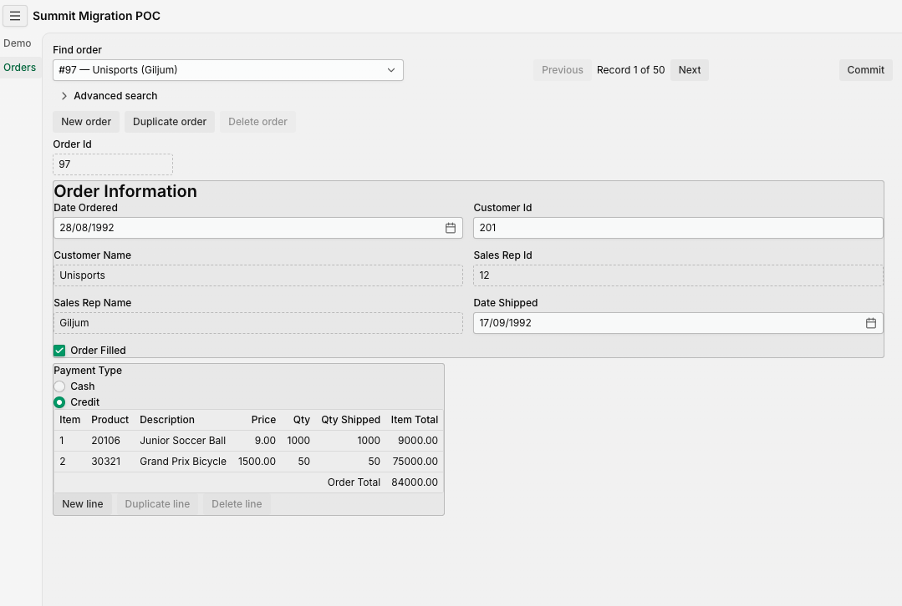
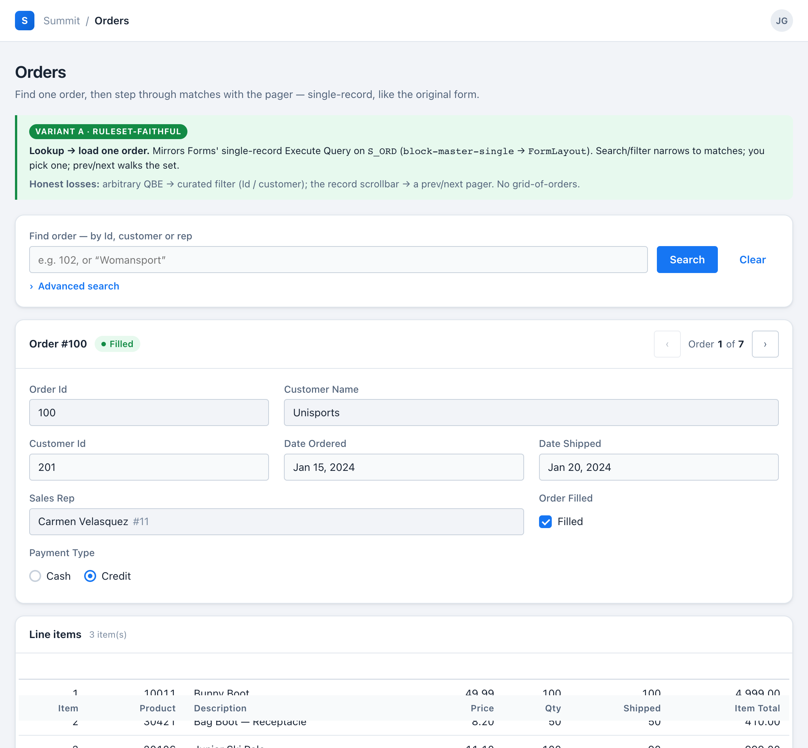

# Migrating Oracle Forms to Vaadin with AI

This is the write-up of a time-boxed proof of concept. We took one representative Oracle
Forms module, migrated it to Vaadin 25 + Spring Boot 4 using a set of composable AI
skills, and then ran the same migration twice more, feeding each pass's corrections back
into the tooling.

Two things are worth measuring in an exercise like this: how much of each construct the
tooling produces without correction, and which corrections can be encoded as rules that
apply to every form rather than as fixes to one. Sections 5 and 6 report both. Section 6
also covers five items that a shipped build was missing while matching the original form on
every check in place at the time, and section 7 states what the result does not
demonstrate.

---

## 1. What we actually migrated

The subject is the **ORDERS** form from Oracle's **Summit** demo schema: the
`S_ORD` master / `S_ITEM` detail spine, with trigger-driven totals, an LOV-backed
product lookup, a credit-rating guard and a `COMMIT_FORM` locking model. In numbers:
**183 form elements, 4 blocks, 34 items, 45 PL/SQL triggers, 1 LOV.**

The target is **Vaadin 25 + Spring Boot 4**, running against the real Oracle database
the form itself runs against. Every migrated construct ships behind a Playwright browser
test that drives the running app against a real Oracle via Testcontainers, exercising
all five layers of the architecture:

```
View  ←  Presenter  ←  Service  ←  Domain  ←  Data (JdbcClient)
```

Small enough to finish inside a time-box; real enough to hit the seams that actually
hurt — optimistic locking, whole-graph commit, lazy-paged lookups.

### Before and after

| Before — Oracle Forms | After — Vaadin, as built |
|---|---|
|  |  |

The structure carries over. The "Order Information" heading and its bordered group are
there, the fields appear in the form's order (Date Ordered, Customer Id, Customer Name,
Sales Rep Id, Sales Rep Name, Date Shipped), Payment Type is still a **radio group**
rather than a text field, Order Filled is still a checkbox, and the line-items grid keeps
the same columns and an order total.

What is new belongs to the web: a lookup field and a `Previous / Record n of m / Next`
pager in place of Execute/Enter-Query and the record scrollbar, an explicit `Commit`, and
New / Duplicate / Delete actions at both master and line level. What is absent is
deliberate — the `Immediate` and `Auto Query` runtime checkboxes and the `Stock`,
`Image On` and `Help` buttons were deferred out of this slice.

One visible difference is worth noting, because it is exactly the class of detail §6 is
about: the ordered date renders as `DD-MON-YYYY` in Forms and `DD/MM/YYYY` in the migrated
view — a format-mask property, not a layout question. (The two screenshots also show
different orders.)

### Styling is a separate concern

The view above is deliberately unstyled beyond component defaults:
[ADR-0008](adr/0008-aura-theme-owns-visual-styling.md) makes the theme the single owner of
visual styling, so Forms' per-field fonts, colours and bevels are **dropped rather than
translated**. Applying a design system is a separate step, and it is what closes the gap
between the screenshot above and this:



*The intended appearance once a design system is applied — from the design prototype,
which is why it carries an annotation box. This is a design target, not the current
build.*

The distinction matters for reading the rest of this post: **structure is migrated, styling
is not.** Getting that line in the wrong place is what §6.1 is about.

### What is migrated

Three parts, and the second is the one most often assumed wrong.

**The same database.** Not a copy, not a converted schema, not a new data model. The
Vaadin app connects to the same Oracle instance the form connects to, and reads and
writes the same tables. **No schema change** — not even to support optimistic locking,
which uses Oracle's built-in `ORA_ROWSCN` pseudocolumn rather than a version column we
add. Nothing in this project is a database migration.

**The PL/SQL *in* the database is not migrated at all.** It stays exactly where it is
and keeps firing. The `AUDIT_S_ITEM` trigger still writes its audit rows — inside the
Vaadin app's own commit transaction, with zero Java written to make that happen. This is
a deliberate boundary, not an omission: **table-level and data-integrity logic belongs to
the database, and moving it into Java would be the mistake.**

**The PL/SQL *in the form* is what gets migrated** — the 45 triggers, formulas and
summaries that live inside the `.fmb`. Each one has exactly one of three fates:

```
                 PL/SQL in the form (45 triggers)
                               │
        ┌──────────────────────┼──────────────────────┐
        ▼                      ▼                      ▼
     STAYS                   MOVES               DISSOLVES
 in the database            to Java         into the architecture
 (data integrity)      (form-serving logic)   (no longer needed)
```

And here is where each construct on the spine actually landed:

| Forms construct | Lands in | As |
|---|---|---|
| `ITEM_TOTAL` formula (`quantity_shipped * price`) | **Domain** | `OrderLine.itemTotal()` — pure, unit-tested |
| `TOTAL` summary (`Sum`) | **Domain** | `Order.total(lines)` — a stream sum |
| `PRE-INSERT` (`MAX(item_id)+1` per order) | **Domain** | `Order.nextItemId()`, computed over working lines |
| `WHEN-VALIDATE-RECORD` (ship-date guard) | **Domain** | `Order.shipDateValid()` — in a Binder validator *and* re-checked on save |
| Credit-rating rule | **Domain** | `PaymentEligibility.allows()` — a set-membership check |
| Delete cascade guard (non-isolated relation) | **Domain** | `Order.hasLineItems()` + `CascadeDeleteBlockedException` |
| `WHEN-VALIDATE-ITEM` (product defaulter) | **Presenter + Service** | `applyProductDefaults()`; `NO_DATA_FOUND → RAISE` becomes a rejected field |
| `WHEN-VALIDATE-ITEM` (customer lookup) | **Presenter + Service** | `lookupCustomer()` |
| `COMMIT_FORM` | **Service** | `OrderService.save()` — one `@Transactional` whole-graph save |
| Pessimistic lock across think-time | **Service + Data** | optimistic `ORA_ROWSCN` re-check, **no schema change** |
| `AUDIT_S_ITEM` table trigger | **stays in the database** | untouched; fires inside the Vaadin commit |
| `get_product_image` function | **dissolves** | the lookup query already fetches the row |
| `POST-QUERY` display re-fetches | **dissolves** | folded into JOINs in the load path — no N+1 |

The boundary rule in one line: **table-level and data-integrity logic stays in the
database; form-serving logic moves to the Java layers; logic the new architecture
absorbs simply dissolves.** The domain formulas quote almost 1:1 from the original
PL/SQL — `itemTotal()` is literally `price × quantityShipped`.

One qualification on that table: Summit is a teaching demo, so its business logic is
deliberately simple. Section 7 quantifies that, and says what it means for how far the
result generalises.

## 2. Why this is hard, and why a naive port misses it

An `.fmb` is not a UI layout. It is a dense bundle of:

- **blocks** bound to base tables, with master-detail **relations** that keep a header
  and its lines navigating together;
- **triggers** carrying validation, defaulting, query and commit logic in PL/SQL;
- **items whose type carries meaning** — a Radio Group says "small fixed choice", an
  LOV says "lookup", a Display Item says "computed, read-only";
- **frames and boilerplate text** that group fields and title sections;
- **LOVs and record groups** backing type-ahead lookups;
- a **locking and commit model** — `COMMIT_FORM` flushes the whole master-detail graph
  as one unit.

A migration that only looks at the screen drops most of this silently. The interesting
work is deciding, construct by construct, what each of these *becomes* on the web — and
being honest about what doesn't survive the trip.

### Runtime behaviour that is not in the file

Everything above is *in* the `.fmb`, so a good analyzer can inventory it. The harder
problem is that **Oracle Forms is a runtime, and a large part of what your users
experience as "the application" is behaviour that runtime provides implicitly.** It is
nowhere in the XML export. There is no element to count, no trigger to read — it is
simply how Forms works, documented in Oracle's manuals and known by your developers.

The clearest example: **validation blocks navigation.** In Forms, a
`WHEN-VALIDATE-ITEM` trigger that raises `FORM_TRIGGER_FAILURE` keeps the cursor in the
field. You *cannot leave* until the value is valid. Validation is not a message shown
next to an input — it is a modal gate wired into the navigation model, cascading item →
record → block → form as the cursor moves. The web has no such thing, and simulating it
faithfully would produce an app nobody wants to use.

Every one of these has to be re-decided rather than translated:

| Forms runtime behaviour | What the web does instead | The seam you must document |
|---|---|---|
| **Validation blocks navigation** — invalid field traps the cursor | Field is flagged; the user can move on, but **save is gated** | You can *leave* an invalid field; you cannot *commit* one |
| **Enter-Query is a modal runtime state** — keystrokes change meaning | A persistent filter bar | Arbitrary query-by-example lost; curated, discoverable filters gained |
| **Row locked on first keystroke**, held across think-time | Optimistic `ORA_ROWSCN` re-check at commit | Conflicts surface at *save*, not at *edit* |
| **Exactly one "current record"**, walked with a record scrollbar | Single-select grid with deselect disabled + a prev/next pager | Fidelity kept, but the scrollbar idiom is gone |
| **Trigger firing order** — item → record → block → form, on cursor movement | Explicit orchestration in the presenter | The cascade must be re-derived by hand; nothing declares it |
| **`MESSAGE()` on a fixed console line**, blocking alerts | Notifications and dialogs | Different attention model entirely |
| **F7 / F8 / F10 keyboard model** | Buttons and actions | Muscle memory does not transfer |

This matters more than it first appears, and it is worth being blunt about: **no
analyzer can count what is not in the file, and no completeness census can prove you
handled it.** The method's guarantee is scoped to the form's contents; the runtime
semantics have to come from someone who knows what Forms actually does — which is
precisely why human sign-off is a separate output rather than a formality (§6.2), and the
same shape as the finding in §6.3: a guarantee about the file cannot cover behaviour that
was never in the file.

## 3. Goals — and non-goals

We are not claiming AI rewrites your forms. The goals were narrower and measurable:

- Find out how much of each construct AI does **unaided**.
- Measure the **ratio of generalizable to specific fixes** — because that ratio *is* a
  Forms shop's automation ceiling (more on this in §5).
- Locate the places where "faithful migration" and "good web app" pull against each
  other, and document those seams instead of papering over them.
- Prove the database is untouched. **No schema change.** That is the first thing a DBA
  will test, and it has to hold.

Explicit non-goals: pixel fidelity (visual styling is deliberately dropped — the theme
owns it, per [ADR-0008](adr/0008-aura-theme-owns-visual-styling.md)), the whole form
(we took the spine), a finished product, and migrating the database logic that should
stay in the database.

What a Forms shop can actually act on is **a classified migration backlog** —
recommended target per construct, decisions flagged, nothing dropped. Not a finished
app.

## 4. The workflow

### 4.1 The pipeline

One form, end to end. Each step consumes the previous one's output.

| Step | What runs | Output |
|---|---|---|
| 0 | `frmf2xml` | `<FORM>_fmb.xml` |
| 1 | `forms-xml-analyzer` — decision-free structural spec | `<FORM>.spec.json` |
| 2 | `to-prd` — **the Vaadin and architecture decisions enter here** | a PRD |
| 3 | disposition-ledger **gate** → construct-grain tickets | `ready-for-agent` issues |
| 4 | implementation — can run unattended | Vaadin view + tests |
| 5 | `migration-review` — human sign-off | `ready-for-human` tickets |

Step 3 is not bookkeeping. Clustering to **construct grain** *is* the
architectural-decision step: roughly seven tickets an architect recognizes — master
block, detail block, filter bar, LOV, totals, locking model — rather than a wall of
forty "migrate KEY-NEXT-ITEM" non-tickets.

### 4.2 Unopinionated, then opinionated

The split between steps 1 and 2 is the load-bearing design choice.

The analyzer records **what the form is**: every block, item, trigger, relation, LOV
and frame, verbatim. It has no Vaadin knowledge and makes no migration decisions — a
Formula item's expression is captured, not translated. The PRD then decides **what it
becomes**, from two published inputs: the mapping ruleset
([`migration-rules.yaml`](migration-rules.yaml)) and the [ADRs](adr/). A different
target architecture produces a different PRD from the *same* spec.

**An example: one radio group.** The ORDERS form has a `PAYMENT_TYPE` item —
Cash or Credit, defaulting to Cash, with a trigger that refuses Credit for customers
whose credit rating isn't good enough. Here is what **step 1** records for it, trimmed
but otherwise verbatim:

```json
{
  "name": "PAYMENT_TYPE",
  "itemType": "Radio Group",
  "prompt": "Payment Type",
  "initializeValue": "CASH",
  "maximumLength": "6",
  "geometry": { "x": "121", "y": "167", "width": "48", "height": "14" },
  "editability": { "updateAllowed": true, "insertAllowed": true, "queryAllowed": true },
  "radioButtons": [
    { "name": "CASH_BUTTON",   "radioButtonValue": "CASH",   "label": "Cash" },
    { "name": "CREDIT_BUTTON", "radioButtonValue": "CREDIT", "label": "Credit" }
  ],
  "triggers": [
    { "name": "WHEN-RADIO-CHANGED", "bodyShape": "select-into",
      "body": "IF :S_ORD.payment_type = 'CREDIT' THEN SELECT credit_rating INTO
               v_credit FROM S_CUSTOMER WHERE :S_ORD.customer_id = id; IF v_credit
               NOT IN ('GOOD','EXCELLENT') THEN :S_ORD.payment_type := 'CASH';
               n := SHOW_ALERT('Payment_Type_Alert'); END IF; END IF;" }
  ]
}
```

Note what is **not** in there. The word "Vaadin" appears nowhere. No component is
chosen. The PL/SQL body is stored as *text* — the analyzer does not decide that this
trigger "is a credit check", only that it exists, that its shape is a `select-into`, and
what it says. Even `geometry` is recorded rather than judged, because deciding whether
pixels matter is not the analyzer's job.

**Step 2** is where every one of those facts gets a fate:

| What step 1 recorded | What step 2 decided | Where that decision came from |
|---|---|---|
| `itemType: "Radio Group"` | a `RadioButtonGroup` | ruleset rule `radio-group` |
| the two `radioButtons` + labels | the group's two options, Cash / Credit | same rule |
| `initializeValue: "CASH"` | `Order.blank()` defaults payment type to Cash | the property rides into the domain factory |
| the `WHEN-RADIO-CHANGED` body | a **pure domain rule** — `PaymentEligibility.allows()`, a set-membership check against `{GOOD, EXCELLENT}` | ADR-0001: business logic lives in the domain layer |
| `SHOW_ALERT('Payment_Type_Alert')` | a Notification shown when credit is refused | ruleset alert mapping |
| `geometry` | **dropped** — but field *order* and *grouping* preserved | ADR-0008 (theme owns styling) + ADR-0012 (structure is not styling) |
| `prompt: "Payment Type"` | the component's own label — the separate boilerplate text object dissolves | ruleset boilerplate rule |
| `maximumLength: "6"` | nothing. A radio group cannot overflow | dissolves |

Two points follow from this example. First, **the same file yields different
decisions under a different architecture**: change ADR-0001 to say business logic lives
in the service layer, or drop ADR-0008 so styling *is* translated, and step 2 produces
different answers from a byte-identical step 1. That is how you test whether a spec is
genuinely decision-free. Second, one small item carries a large amount of decision
surface: this radio group generates **five rows** in the disposition ledger described in
§6.4, including one for the `CASH` default, which a screen-level review would not
normally check.

That separation is also what makes a correction **routable**. When generated code is
wrong, you can say which box failed: bad ticket → fix the *ruleset*; ticket right but
code buggy → fix the *execution skill*; irreducible form quirk → hand-fix and touch no
skill. A single black box makes that diagnosis impossible, and without the diagnosis
nothing downstream compounds.

### 4.3 The inner loop: per construct

Riskiest construct first, while a rebuild is still cheap:

1. **Generate** the construct from its ticket.
2. **Validate** against the live Forms app — the behavioural oracle.
3. **Diagnose which layer failed** (the routing above).
4. **Sort the fix** — generalizable or specific.

Two rules keep this from becoming a grind. **Cap refinement at about two passes per
construct.** And if a construct won't converge, **stop and write it up**:
non-convergence is the most valuable finding, not a reason to keep pushing.

## 5. Sorting corrections: generalizable or specific

Every correction you make to AI-generated code is one of exactly two things.

- **Generalizable** — a rule the tool *should* have known. You push it back into the
  mapping ruleset, and it now works for **every form, forever**.
- **Specific** — an irreducible quirk of *this* form. You hand-fix it, log it, move on.
  It teaches the tool nothing.

The reusable asset is the accumulated generalizable set; it gets smarter every time a
fix is sorted correctly. And one rule keeps the whole thing honest: **a fix is
"specific" by default.** It only earns generalizable status when the rule behind it can
be stated in *form-construct terms* — "any table-level audit trigger stays in the
database", not "the ORDERS header needed an extra field". That conservatism is exactly
what separates a reusable ruleset from one quietly overfit to Summit.

## 6. Three iterations, three different lessons

We ran the whole migration three times. Crucially, each pass is **not a patched version
of the last one**: after sorting every correction and pushing the generalizable ones into
the ruleset and the skills, the entire slice was **regenerated from scratch**. So each
pass is what the *smarter tool* produces on the same form — which is what makes the
compounding measurable rather than merely asserted.

| Pass | What changed in the tool | What it caught | What it still missed |
|---|---|---|---|
| **v1** | First full attempt | A working spine — and the *counted ≠ rendered* gap, found mid-build | Layout drift shipped before anything caught it |
| **v2** | Layout fidelity front-loaded; record actions became a rule; human judgment became an up-front output | Whole capability families arrived **for free**; the spine finished | Four features that had spec data *and* a rule, never built |
| **v3** | A **disposition ledger** gating ticket-cutting at property grain | All four losses, by construction, before code exists | Designed, **never built** — unproven at scale |

### 6.1 v1 — the spec census does not prove the screen is right

The migrated ORDERS header shipped with its fields **reordered**, its bordered "Order
Information" group **gone**, its section title **missing**, and `PAYMENT_TYPE`
**flattened from a radio group to a text field**.

Meanwhile the spec census cheerfully read: *183 elements, nothing dropped.*

The root cause was over-reach in a rule we'd written on purpose. Dropping visual
styling was correct; dropping field **geometry** wholesale was not — because geometry
encodes *structure* (order, grouping), not just pixels. Only the pixels were the
theme's to drop.

Two corrections came out of it, both now first-class rules.
[ADR-0012](adr/0012-structural-layout-fidelity.md): structural layout fidelity **is**
migrated — field order, frame grouping and section titles preserved, and a view is not
done until a **layout-fidelity test** asserts every in-scope item, frame and heading
renders, in the form's order, as its mapped component type.
[ADR-0013](adr/0013-read-only-is-a-state-not-a-type.md): **read-only is a state, not a
component type** — a read-only slice still renders a disabled `RadioButtonGroup`, not a
`TextField` printing `CASH`.

This applies beyond this form: a test that asserts only behaviour passes even when the
screen is wrong, so layout fidelity needs a separate gate.

### 6.2 v2 — regenerating with the corrected ruleset

Three of v1's corrections generalized, and each traces from a v1 hand-fix, into the
tool, to a v2 payoff.

**Layout fidelity.** In v1 this was found mid-build and retrofitted. In v2 the gate is
part of the first structural slice.

**Record actions: a hand-fix that became a ruleset rule.** In v1, "create a new order" was a one-off hand-written flow on the presenter,
there was **no Duplicate at all**, and although a delete path existed in the service it
was never wired to a visible control. A classic un-sorted hand-fix: it made *this* form
work and taught the tool nothing. Sorted, the rule states in form-construct terms —
*any base-table block whose CRUD capability permits insert/delete gets New / Duplicate /
Delete record actions, whether or not a `KEY-CREREC` / `KEY-DUPREC` / `KEY-DELREC`
trigger exists*. v2 regenerated against that rule and got the whole family for free, at
master **and** line level, with Delete correctly composed against the non-isolated
cascade-delete guard. One hand-fix became a capability every subsequent form inherits.

**Human judgment as an explicit output.** Work that turns on a judgment an agent is not
entitled to make became a separate, up-front deliverable rather than something handled
reactively during the build ([ADR-0014](adr/0014-hitl-review-tickets.md)) — the mechanism
is the review skill described in §6.3.

v2 also finished the spine — the product LOV defaulter, master-header editing with the
credit-check and ship-date guards, and the whole-graph `COMMIT_FORM` save under an
`ORA_ROWSCN` optimistic-lock check. Read the SCN on load, re-check it in
`UPDATE … WHERE id = ? AND ORA_ROWSCN = ?`; zero rows updated means a conflict, so roll
back. **No schema change.**

### 6.3 v3 — traceability from spec fact to test

v2 matched the live form on the spine flow. To check whether that was enough, the
**`migration-review`** skill audits a shipped build against the structural spec: it walks
every decision-prone fact — defaults, editability modes, cross-form contracts, and any
"this form has no X" claim in the code — and asks whether the build *consumed* it, rather
than whether the application looks right. Its findings become `ready-for-human` tickets.

Run against v2, it found five items:

| What was absent from the build | Kind of fact |
|---|---|
| `GLOBAL.customer_id` — ORDERS can be launched already filtered to a customer; three triggers read, default from, and clear it | cross-form contract |
| `DATE_ORDERED` should default to today (`$$date$$`) | default value |
| `QUANTITY_SHIPPED` is editable while a line is new, read-only once saved | editability mode |
| `SALES_REP_ID` was made read-only — correct, but never recorded as a deviation from the spec's "editable" | undocumented re-decision |
| A comment asserting "`S_ORD` has no `WHEN-CREATE-RECORD`", which nothing checked against the spec. It has one | false absence claim |

**All five were present in the spec, and four had a matching ruleset entry.** The tooling
was not missing a rule; nothing consumed the fact. Every check in place at the time passed:

| Check | What it proved | Why it missed these |
|---|---|---|
| Spec census (183 elements) | every node counted | counted is not consumed |
| Tickets and scorecard | "migrate the master block" | construct grain is too coarse to see one property inside a construct |
| Deferred-surface lane | whole surfaces tracked | tracks surfaces, not properties |
| Layout-fidelity gate | every field renders, in order | a default has no visible absence |

### 6.4 v3 — the traceability chain

v3 adds **no new mapping rules**. It adds a link from every decision-prone spec fact to
the ticket that implements it and the test that asserts it, and it refuses to generate
tickets until that link exists:

```
  spec fact          ledger row          build ticket        acceptance         UI test
  (a default,   →    + disposition   →   + Covers: rows  →   criterion      →   asserts it
   an editability     (151 rows for       + per-field         (one per           at runtime
   mode, a :GLOBAL    ORDERS)             fidelity matrix     covered row)
   contract)
                          │                                                        │
                          └── gate: no tickets are generated while any row          │
                              is unassigned  ── and ──  --check-refs verifies ──────┘
                              cited tickets exist and deferred rows stay open
```

Read left to right it is a specification; read right to left it is an audit trail. The two
ends are what the previous passes lacked: a fact with no ledger row could not be missed
*before* v3 only because nothing was looking, and a `migrated-as` row with no test proves
the property was *decided*, not that it was *delivered*.

The four dispositions a row may carry:

| Disposition | Meaning | Also recorded on the row |
|---|---|---|
| `migrated-as` | built, with the web behaviour named | the ticket or PR that carries it |
| `re-decided` | deliberately different from Forms | the rationale and who decided |
| `deferred` | accepted, not in this slice | an open tracking ticket |
| `obsolete` | Forms-runtime plumbing with no web counterpart | the rule id that dissolves it |

The practical effect is on the ticket. The implementer builds against a matrix of field
properties instead of interpreting a paragraph; the reviewer checks a named list of rows
instead of re-reading the form to work out what should have been there. The same
construct, specified under each version — note that **#45 shipped, while #91 is the ticket
as v3 generates it, not one that was built** (see §7):

| | **v2 — issue #45** (shipped) | **v3 — issue #91** (generated, not built) |
|---|---|---|
| Covers | — | **12 ledger row ids**, incl. `property:S_ITEM.QUANTITY_SHIPPED.editability` |
| Field fidelity | prose description | a per-field matrix |
| `QUANTITY_SHIPPED` | not mentioned | an insert-only row: editable while new, read-only once saved |
| Acceptance criteria | a checklist | a checklist **+ a UI test** asserting the insert-only behaviour |

The v2 ticket had no field in which that property could appear, so its omission was not
visible to the implementer or the reviewer.

### 6.5 Summary of the three iterations

v1 → v2 shows generalizable fixes accumulating in the ruleset. v2 → v3 extends the
completeness guarantee from the form's contents to the migration's contents: "nothing
dropped silently" now holds at three levels — the spec census (every element accounted
for), the slice boundary (every deferred surface tracked), and migration content (every
decision-prone property carries a disposition, backed by a test or a tracked defer).

## 7. Limitations

Four qualifications bound everything above.

**v3 was never built.** The PRD, the 151-row ledger and ADR-0015 exist on `master`; the
v3 build tickets never landed. Every claim that the ledger *would have* caught those
four losses is a **paper claim** until someone runs it.

**The sample is a teaching demo, so its business logic was always simple.** Summit is
Oracle's demonstration schema, and its business rules are deliberately uncomplicated. The
whole form is about 500 lines of PL/SQL, roughly half of it Oracle-generated master-detail
boilerplate; of the hand-written remainder, about 34 of 45 triggers are a single built-in
call, assignment or `SELECT INTO`. There are **zero** PL/SQL packages, no dynamic SQL, no
cursors over large sets, no package state and no differentiated error handling, and the one
trigger that rises to moderately complex was deferred out of the slice.

**The AI interpreted that logic accurately** — every trigger and formula on the spine has a
traceable Java counterpart, and the domain methods quote almost 1:1 from the PL/SQL. That
result stands. What it does not tell us is whether the same holds for production logic:
domain rules living in stateful DB packages, dynamic `DEFAULT_WHERE` query building,
validation that accumulates several errors before failing, `ON-INSERT`/`ON-UPDATE`
transaction overrides. **We did not find a form like that to try** — so this is an untested
case, not a failed one, and §9 names it as the experiment that would settle it.

**One canvas, one very large view.** Multi-canvas topology was never exercised — the
other two canvases were deferred. And `OrderView.java` is about **1,158 lines**, mixing
structure and event wiring. Fine on a demo; a maintainability cliff at five times the
fields.

**The ledger is unproven at scale.** 151 rows for a 34-item demo plausibly means
*thousands* for a real module. Who assigns dispositions to 3,000 rows without
rubber-stamping? And "which properties are decision-prone" is itself a judgment — which
arguably reintroduces the silent-loss risk one level up. Worth noting too: the four
losses were caught by a retrofit audit, not by the ledger.

What *is* solid is the part that looks least glamorous: the architecture and concurrency
work. Whole-graph transactional commit with a validate-gate first and the SCN-guarded
header `UPDATE` as the first write, so a conflict leaves the database untouched.
Optimistic locking translated from Forms' pessimistic-across-think-time model with no
schema change. Business rules in pure, unit-testable domain types. The `AUDIT_S_ITEM`
trigger left in the database, firing transparently inside the commit's transaction, zero
Java written. That's the real engineering, and it holds.

## 8. How to try it

**Tier 1 — guaranteed.** Clone, `docker compose up`, `mvn spring-boot:run`. The Summit
slice runs against a self-contained Oracle Free container seeded from a committed dump
(75 tables, ~54k rows; the POC slice loads intact). A stranger needs Docker — not an
Oracle licence, and not your Forms database.

**Tier 2 — honest.** The skills, the mapping ruleset and the ADRs. Applied to *your*
form, the method gives you a **classified migration backlog** — recommended target per
construct, decisions flagged, nothing dropped. **Not a finished app.**

Stated plainly: this reproduces the Summit migration exactly; on your own form it produces
a documented starting point rather than a finished product, and it identifies where the
remaining work is.

## 9. Open questions and next experiments

Two experiments would test the parts that are currently unproven.

**Build v3.** Prove the four ledger rows force the four missing features into
existence. That is the only real proof the gate works, and it is cheap — the plan
already exists.

**Then run the method on a form with real PL/SQL:** logic living in a stateful DB
package, dynamic `DEFAULT_WHERE` query building, `ON-INSERT`/`ON-UPDATE` overrides,
validation that accumulates multiple errors before failing. That last one is where the
whole-graph `save()` assumption breaks.

The hypothesis: formulas migrate straightforwardly at any scale, and what breaks first in
a production application is packaged, stateful logic that the layer boundary cannot hold,
followed by the volume of decision-prone properties exceeding what a ledger can usefully
track.

---

## Implications for a Forms estate

- AI does a large fraction of each construct **unaided**, and that fraction is
  **measurable**.
- Corrections sort cleanly into *teach the tool once* versus *fix this one form by
  hand* — and the first bucket **compounds across your whole estate**.
- The genuinely hard parts — arbitrary query-by-example, modal validation semantics,
  pixel fidelity — are **knowable in advance and small in number**. You can plan around
  them instead of discovering them mid-project.
- And the failure that should scare you is not the loss you argue about in review. **It
  is the one nobody noticed was gone.**

The generalizable-to-specific ratio is the measurable number, and this POC is a way to
establish it on one form before committing to a migration programme.

---

*Built with Vaadin 25, Spring Boot 4, Oracle Free, and a set of composable AI migration
skills. The mapping ruleset, the ADRs behind every decision above, the full ORDERS spec
and the disposition ledger are all in this repository.*
